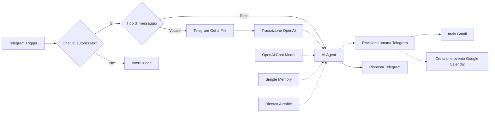

# Assistente AI personale — n8n × OpenAI × Telegram

Un **workflow n8n importabile** per un assistente AI personale che riceve messaggi testuali e vocali tramite Telegram, consulta una rubrica Airtable, prepara email con Gmail e crea eventi su Google Calendar. Le operazioni che modificano servizi esterni richiedono un'approvazione umana esplicita.

> **Progetto dimostrativo e da portfolio.** Il workflow è distribuito come modello di configurazione, non come servizio già ospitato. Per utilizzarlo occorrono account, credenziali, identificativi e dati di prova propri. Il JSON condiviso è stato ripulito dai riferimenti personali e l'attivazione automatica è disabilitata per evitare esecuzioni involontarie dopo l'importazione.

## Architettura



**Distinzione importante:** la ricerca in Airtable è collegata direttamente all'agente, perché serve a consultare dati. Gli strumenti Gmail e Google Calendar sono invece collegati tramite il nodo di revisione umana su Telegram, che propone i pulsanti **Approva** e **Rifiuta**. Le istruzioni dell'agente prevedono anche una conferma esplicita in conversazione prima di avviare queste operazioni.

## Componenti principali

| Funzionalità | Implementazione in n8n |
| --- | --- |
| Interfaccia utente | `Telegram Trigger`, `Send a text message` |
| Controllo degli accessi | `If`, che confronta il Chat ID ricevuto con quello autorizzato |
| Smistamento messaggi | `Switch`: uscita 0 per testo, uscita 1 per vocale |
| Elaborazione vocale | `Get a file` → `Transcribe a recording` |
| Agente AI | `AI Agent` con `OpenAI Chat Model` (modello `gpt-5-mini` nel JSON originale) |
| Memoria | `Simple Memory`, sessione associata al Chat ID Telegram, **finestra di contesto pari a 15** |
| Ricerca contatti | `Search records in Airtable` |
| Invio email | `Invio email Gmail`, soggetto ad approvazione Telegram |
| Calendario | `Create an event in Google Calendar`, soggetto ad approvazione Telegram |
| Approvazione | Nodo Telegram Human-in-the-Loop (`Telegram`) con pulsanti Approva / Rifiuta |

L'agente riceve direttamente il testo dei messaggi scritti. Per i vocali utilizza il campo prodotto dalla trascrizione (`$json.text`). Il **System Message** include la data e l'ora correnti con fuso `Europe/Rome`, ottenute tramite `$now.setZone('Europe/Rome')`, per interpretare espressioni temporali relative.

## Contenuto del repository

```text
n8n-ai-personal-assistant/
├── README.md
├── workflow/
│   └── ai-personal-assistant.json
├── docs/
│   └── SETUP.md
└── assets/
    └── .gitkeep
```

## Importazione e configurazione

1. Scarica `workflow/ai-personal-assistant.json`.
2. Apri un'istanza n8n compatibile con i tipi e le versioni dei nodi utilizzati. Nell'editor scegli **Import from File** (la dicitura può variare in base alla versione di n8n).
3. Crea e collega le **tue credenziali** Telegram, OpenAI, Airtable, Gmail OAuth2 e Google Calendar OAuth2 ai rispettivi nodi. Se la tua istanza non dispone di un gateway OpenAI gestito, utilizza credenziali API OpenAI personali con accesso e credito adeguati.
4. Nel nodo **If**, sostituisci `REPLACE_WITH_YOUR_TELEGRAM_CHAT_ID` con il tuo Chat ID Telegram numerico, inserito **come testo**.
5. Nel nodo **Telegram** dedicato alla revisione umana, sostituisci il Chat ID di destinazione `REPLACE_WITH_YOUR_TELEGRAM_CHAT_ID`.
6. Nel nodo **Search records in Airtable**, seleziona la tua base e la tua tabella, sostituendo i due valori `REPLACE_WITH_...`. Prepara una tabella contatti con almeno i campi necessari all'agente, ad esempio nome, cognome, email e telefono.
7. Nel nodo **Create an event in Google Calendar**, scegli il calendario di destinazione al posto di `REPLACE_WITH_YOUR_CALENDAR_ID`.
8. Controlla il **System Message** dell'AI Agent e la coerenza dei nomi degli strumenti. Verifica credenziali, trigger, identità dell'approvatore e autorizzazioni.
9. Esegui test su testo → ricerca Airtable e vocale → trascrizione → risposta. Prova poi Gmail e Calendar **con account sotto il tuo controllo**, verificando sia l'approvazione sia il rifiuto.
10. Pubblica/attiva il workflow soltanto dopo i test. Con lo stesso bot Telegram potrebbe non essere possibile ascoltare contemporaneamente gli eventi in modalità produzione e quelli di test nell'editor.

Per la checklist dettagliata consulta [docs/SETUP.md](docs/SETUP.md).

## Sicurezza e limiti

- Il workflow condiviso è stato ripulito dal Chat ID Telegram originale, dall'indirizzo email personale del calendario, dagli identificativi della base e della tabella Airtable, dai riferimenti alle credenziali, dagli identificativi dei webhook e dai metadati dell'istanza. **Non pubblicare l'esportazione originale non anonimizzata di n8n.**
- Non caricare mai token API, token OAuth, Personal Access Token Airtable, segreti del bot Telegram o dati grezzi delle esecuzioni. Anche le schermate possono contenere dati riservati.
- Il filtro basato sul Chat ID costituisce una lista di autorizzazione per un singolo utente a scopo dimostrativo, **non un sistema completo di autenticazione e autorizzazione per la produzione**.
- La revisione umana riduce il rischio di invii e creazioni accidentali, ma non sostituisce la corretta gestione dei permessi, il controllo dei destinatari, i log di audit e i limiti di utilizzo.
- Simple Memory conserva il contesto conversazionale associato alla sessione; non è un database persistente e condiviso tra diverse installazioni.
- L'importazione non trasferisce credenziali attive, contatti Airtable, email Gmail, eventi del calendario o cronologia delle chat Telegram.
- L'anteprima delle operazioni da approvare mostra i parametri tecnici in formato JSON; una possibile evoluzione è renderli più leggibili e localizzati.
- Lo Switch gestisce attualmente messaggi Telegram di tipo **testo** e **vocale**. Per altri formati sono necessarie regole aggiuntive.

## Funzionalità realizzate e dimostrate

Il progetto originale è stato mostrato attraverso messaggi Telegram, ricerche nella rubrica, approvazioni per l'invio di email, creazione di eventi Calendar e trascrizione vocale. Nel feedback del docente sono stati suggeriti ulteriori miglioramenti alla **documentazione delle prove**: mostrare l'output del nodo di trascrizione, l'interpretazione di date relative, il rifiuto delle approvazioni e il blocco di chat non autorizzate. Non tutti questi casi risultano documentati nel video consegnato.

## Sviluppi futuri

- [ ] Rendere più leggibili i messaggi di approvazione: destinatario, oggetto e corpo per Gmail; data, inizio, fine e descrizione per Calendar
- [ ] Assegnare nomi espliciti **Testo** e **Vocale** alle uscite dello Switch
- [ ] Documentare test separati per Chat ID non autorizzati e rifiuto dell'approvazione
- [ ] Registrare una breve dimostrazione del percorso vocale, mostrando anche l'output della trascrizione
- [ ] Verificare date relative come «domani» mostrando il timestamp ottenuto
- [ ] Aggiungere schermate e PDF di presentazione

## Licenza

Non è stata ancora selezionata una licenza. Se vuoi concedere esplicitamente diritti di riutilizzo e redistribuzione oltre a quelli previsti dalle condizioni standard di GitHub, aggiungi una licenza appropriata.
